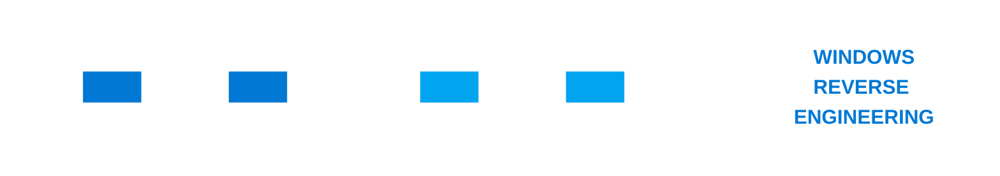

## Android Reverse Engineering Course

## Linux Reverse Engineering Course

## Windows Reverse Engineering Course

- **`WINRE-I`**: Fundamentals of Windows Binary Reverse Engineering
- **`WINRE-II`**: Windows Binary Reverse Engineering: Static and Dynamic Analysis
- **`WINRE-III`**: Advanced Windows Reverse Engineering and Program Reconstruction

